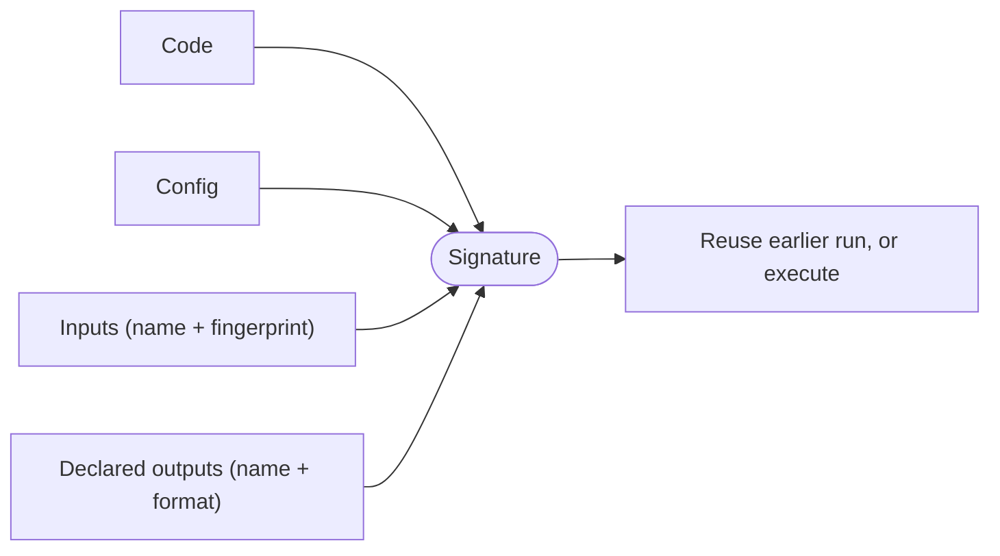

# How Consist Works

Consist tracks three things about every file your workflow touches:

1. **What is it called?** Its **name** inside a step — for example, `"raw_trips"` or `"cleaned"`.
2. **What does it contain?** Its **fingerprint** — a hash of the file's contents.
3. **Where is it?** Its **location** — a path on disk or a table in DuckDB where those contents can be read right now.

Consist keeps these three answers separate on purpose:

- **Renaming or moving a file** changes its location, not its fingerprint.
- **Re-running a step that produces identical bytes** creates a new run, not a new fingerprint.
- **Swapping two inputs** changes which name points to which fingerprint, even though the files themselves did not change.

An **artifact** is the handle you get back from Consist that ties all three together:

| Question | Term | In code |
| :--- | :--- | :--- |
| What was it called when it was produced? | **Name** | `art.key` |
| What does it contain? | **Fingerprint** | `art.hash` |
| Where can I read it right now? | **Location** | `art.path`, `art.locations` |

The same artifact can have a different name in each step that uses it; names are recorded per run.

---

<a id="how-caching-works"></a>

## A run is a recipe

When you call `tracker.run(...)` or `scenario.run(...)`, Consist builds a **signature** from the step's recipe before running your function:



The recipe includes:

- **Code** — the identity of the function or container being executed (plus any declared extra file dependencies).
- **Config** — the canonical JSON representation of your `config` dictionary or Pydantic model.
- **Inputs** — each input's **name** and **fingerprint** (plus any sub-table or array selector).
- **Declared outputs** — when outputs are declared upfront (such as `outputs={"cleaned": "cleaned.parquet"}`), their **names** and **file names/formats** (never resolved workspace paths).

Notice what is **not** in the signature: **locations**. Consist cares *what* an input contains and *which parameter* it is passed to, not which folder or machine it currently sits in. Likewise, declared output filenames capture the requested format (`"cleaned.parquet"` vs. `"cleaned.csv"`) without baking your machine's `run_dir` path into the signature.

---

## When is a result reused?

Before executing a step, Consist checks whether an earlier completed run has the same **signature**. If it does, the step is skipped, even if that run's output files have since been deleted. Consist only needs the files when something reads them: a later step that has to execute, or your own code calling `.path` or `.as_df()`.

| If you change... | Reused? | Why |
| :--- | :--- | :--- |
| the contents of an input | No | Its fingerprint changed |
| a config value | No | The config is part of the recipe |
| your function's code | No | The code is part of the recipe |
| which parameter an input goes to | No | Input names are part of the recipe |
| a declared output's name or file format (`cleaned.parquet` -> `cleaned.csv`) | No | Declared output names and formats are part of the recipe |
| where an input or run directory lives (moved, archived, copied) | **Yes** | Locations aren't part of the recipe |
| an upstream step, which then produced identical output | **Yes** | Downstream steps see the same fingerprint |
| `runtime_kwargs` | **Yes** | Treated as runtime tuning, not part of the recipe |

> [!NOTE]
> **Containers and host volume paths:** One exception: unmounted host volume paths are part of a container step's recipe. When you map host directories through `tracker.mounts`, Consist records portable mount prefixes (`inputs://...`, `workspace://...`) so moving a mounted directory across machines still reuses cached runs; see the [Container Integration Guide](containers-guide.md) for details.

### Cache modes

You can control how Consist uses the cache on any run via `cache_mode`:

| Mode | Behavior |
| :--- | :--- |
| `reuse` (default) | Reuse a matching prior run by signature; otherwise execute the step. |
| `overwrite` | Always execute the step and record the new outputs as the latest result. |
| `readonly` | Reuse matching cached runs, or execute and write output files and `consist.json` to `run_dir` without writing new records to `provenance.duckdb`. |

---

## What you get on a cache hit

Whether a step ran fresh or hit the cache, `tracker.run(...)` returns a `RunResult` containing output **artifacts**:

```python
result = tracker.run(
    fn=clean_passengers,
    inputs={"raw": "data/passengers.csv"},
    outputs={"cleaned": "cleaned.parquet"},
    config={"min_age": 18},
)

if result.cache_hit:
    print("Reused cached result!")

cleaned = result.outputs["cleaned"]
print(cleaned.path)      # Current readable Path on disk
df = cleaned.as_df()     # Load directly into a DataFrame
```

Don't build paths to output files yourself. On a cache hit, `cleaned.path` points to wherever the contents are now — whether in the original run folder or a shared archive. If no copy exists anywhere on disk, reading the file (or calling `.as_df()` without a DuckDB copy) raises `FileNotFoundError`.

### Ghost Mode

Because Consist separates an artifact's **fingerprint** from its **location**, you can delete bulky intermediate outputs to save disk space without losing provenance ("Ghost Mode"):

- **Unchanged pipelines skip every step:** In a pipeline `A → B → C`, if you delete `A`'s outputs on disk but keep `B`'s, rerunning the pipeline skips all three steps. `B`'s signature depends on the *fingerprint* of `A`'s output — which Consist still has in the database — not on the file itself.
- **Downstream changes only need the immediate parent's output:** If you later change `C`'s code or config while `A`'s output is still deleted, `A` and `B` still hit the cache and `C` executes normally using `B`'s surviving output file, without ever regenerating `A`.
- **Ingested tables stay readable without files:** If an intermediate artifact was ingested into DuckDB, `artifact.as_df()` (and downstream steps with `input_binding="loaded"`) can still load it directly from the database after the file on disk is gone.
- **When a deleted file *is* needed again:** If `B` itself misses (for example, you change `B`'s code) and `A`'s output was neither archived nor ingested, `B` raises an error naming `A`'s artifact and producing `run_id` and explaining how to regenerate `A` (by running `A` with `validate_cached_outputs="eager"` or `cache_mode="overwrite"`).

---

## Where files live

By default, each step writes its outputs into a subfolder of `run_dir`. To keep workflows portable across laptops, servers, and HPC clusters, you can configure named `mounts` on your `Tracker`:

```python
tracker = Tracker(
    run_dir="./runs",
    db_path="./provenance.duckdb",
    mounts={
        "inputs": "/shared/data/inputs",
        "archive": "/mnt/nfs/project_archive",
    },
)
```

When a file lives inside a configured mount, Consist records its location relative to that mount (for example, `inputs://land_use.csv`). When you move to another machine and point `"inputs"` at that machine's folder, Consist resolves the location automatically. See [Mounts & Portability](mounts-and-portability.md) for the complete guide.

---

## What gets recorded

Consist records every run in two places:

1. **`consist.json` (per-run snapshot):** Written atomically inside each run directory when the step finishes. It is a self-contained, human-readable snapshot of that run's recipe, signature, input/output names, fingerprints, and initial locations at the moment the run completed.
2. **`provenance.duckdb` (analytics and location index):** Indexes all runs, fingerprints, and current locations in DuckDB for fast lineage queries, cache lookups, and cross-run comparisons. Post-run location updates — such as archiving files to cold storage, evicting scratch directories, or promoting migrated runs — are tracked in `provenance.duckdb`. If the database is ever lost, run history and fingerprints can be reconstructed from your `consist.json` snapshots and surviving files on disk.

<a id="data-virtualization"></a>

### Querying across runs

Because `provenance.duckdb` indexes every run and artifact, you can query outputs across dozens of scenarios or simulation years at once. Consist's **hybrid views** combine rows ingested into DuckDB with raw Parquet/CSV/Zarr files on disk in a single SQL view, tagging rows with `consist_run_id`, `consist_year`, and `consist_scenario_id`. See [Data Storage and Ingestion](concepts/data-materialization.md) and the [CLI Reference](cli-reference.md) for examples.

---

## Upgraded from 0.4?

If you upgraded an existing project from Consist 0.4 using `consist migrate <db_path>`, Consist verifies existing files on disk and computes their v2 fingerprints. In `--quick` mode (`consist migrate <db_path> --quick`), any artifact whose v1 record already had a full SHA-256 hash, a directory manifest, a logical matrix hash, or an ingested DuckDB table keeps its verified status immediately.

Only historical runs whose files were already deleted or overwritten, or whose v1 record only had a quick size-and-timestamp check (`--quick` skips re-reading these from disk), become **history-only**:

- They remain **fully visible** in lineage graphs, run queries, and hybrid views.
- They **never produce a false cache hit**, because their original file contents were not verified on disk during migration.
- If you later restore or mount the original file, you can upgrade that artifact to full cache-eligible status at any time:

```bash
consist promote ./provenance.duckdb <artifact-id-or-run-id> --mount archive=/path/to/archive
```

---

## Going deeper

- [Caching & Hydration](concepts/caching-and-hydration.md) — cache modes, materialization options, and Ghost Mode recovery patterns.
- [Mounts & Portability](mounts-and-portability.md) — configuring portable mounts and relocating run directories across machines.
- [Container Integration Guide](containers-guide.md) — running Docker and Apptainer steps with portable volume mounts.
- [Internals](internals.md) — contributor reference covering the DuckDB hub-and-spokes store schema, digest schemes, location witnesses, and migration architecture.
