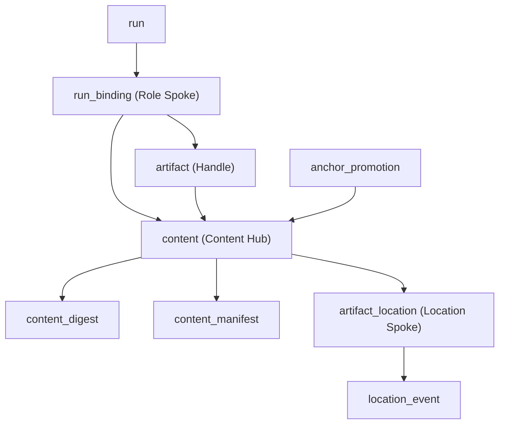

# Internals

This page documents Consist's internal v2 store schema, digest schemes, signature construction, location freshness verification, and migration pipeline. It is intended for Consist contributors and power users inspecting `provenance.duckdb` directly.

For the user-facing mental model, see [How Consist Works](architecture.md).

---

## The Hub-and-Spokes Data Model (The Artifact Triad)

In user-facing code, an `Artifact` ties together three concepts: its **name** (`art.key`), its **fingerprint** (`art.identity` / `art.anchor`), and its **location** (`art.path` / `art.primary_location`). Inside `provenance.duckdb`, Consist normalizes these three concerns into a **Hub-and-Spokes** schema (`consist.store.schema_v2.sql`):



### Mapping User-Facing Terms to Store Tables

| User-facing concept | Public v2 API | Internal store representation |
| :--- | :--- | :--- |
| **Fingerprint** | `art.identity`, `art.anchor` | `content.anchor` (`VARCHAR` primary key, formatted `<scheme>:<hex>`) + `content_digest(anchor, scheme, value, basis)` |
| **Name** | `art.key`, `inputs`/`outputs` keys | `run_binding.slot` (paired with `direction`, `ordinal`, `role`, `anchor`, and `artifact_id`) and `artifact.key` |
| **Location** | `art.path`, `art.primary_location`, `art.uri` | `artifact_location` observations + `location_event` status transitions, queried via `artifact_location_current` and `locate_current(anchors)` |
| **Artifact** | `Artifact` | `artifact(id, key, driver, anchor, run_id, schema_id, meta, created_at)` |
| **Run** | `Run` | `run(id, model_name, status, code_hash, config_hash, input_hash, signature, signature_scheme, cache_status, ...)` |

### 1. The Content Hub (`content`, `content_digest`, `content_manifest`)

- **`content`**: Keyed by `anchor` (the canonical `<scheme>:<value>` string). Tracks `repr_kind` (`file`, `tree`, `table`, `array`, `bundle`, or `historical`) and optional `schema_id`.
- **`content_digest`**: Stores all computed digests for a given `anchor` (`PRIMARY KEY (anchor, scheme)`), enabling multi-digest equivalence lookups via `idx_content_digest_lookup(scheme, value)`. Conflicting digest assertions for the same `(anchor, scheme)` are audited in `content_digest_conflict`.
- **`content_manifest`**: Stores canonical binary/JSON structural manifests for directory trees and multi-member bundles alongside `digest_policy(policy_sha256, policy_json)`.
- **`content_derivation`**: Tracks cross-representation relationships (`src_anchor`, `dst_anchor`, `kind`), such as ingesting a Parquet file into a DuckDB table or materializing a table back to disk.

### 2. The Role Spoke (`run`, `run_binding`, `artifact`)

- **`run_binding`**: Records every input and output binding occurrence for a run (`PRIMARY KEY (run_id, direction, slot, ordinal)`). Stores the bound `artifact_id`, `anchor`, `role`, `contract_scheme`, and per-binding signature contribution (`sig_scheme`, `sig_hex`).
- **Compatibility views**: `run_artifact_link` and `run_artifact_role` are SQL views over `run_binding` that preserve query compatibility for tools inspecting `(run_id, artifact_id, direction)`.

### 3. The Location Spoke (`artifact_location`, `location_event`, `artifact_location_current`)

- **`artifact_location`**: Append-oriented observations of where an `anchor`'s bytes reside (`observation_id`, `anchor`, `uri`, `member`, `access_driver`, `witness_json`, `basis`, `site`, `scope_key`, `mount_instance_id`, `observed_at_ns`, `writer`).
- **`location_event`**: Monotonic lifecycle transitions (`active` → `staged` / `archived` → `evicted` / `corrupt`) ordered by `status_rank` and `at_ns`.
- **`artifact_location_current` & `locate_current(anchors)`**: Windowed view and table macro that resolve the latest observation at each physical place `(site, scope_key, mount_instance_id, uri, member)` joined with its highest-ranked lifecycle status. If a newer run overwrites the same path on disk with a different `anchor`, place-supersession automatically shadows the older observation at that URI.

---

## Digest Schemes & Multi-Digest Equivalence

Consist represents every fingerprint via `Identity(anchor, claims=())` (`consist.digest.Identity`):

| Scheme | `Kind` | Description |
| :--- | :--- | :--- |
| `sha256:file` | `Kind.BYTES` | Full-file SHA-256 digest of a regular file on disk. |
| `sha256:manifest-v1` | `Kind.CONTAINER` | Canonical structural manifest digest over a directory tree, Zarr store, or multi-file bundle (recording relative paths, entry types, sizes, and per-entry `sha256:file` digests under a recorded `FilterPolicy`). |
| `ctd1:sha256` | `Kind.LOGICAL` | Canonical Tabular Digest v1 over arrow/tabular schemas and row contents, allowing format-independent semantic equivalence between Parquet, CSV, and ingested DuckDB tables. |
| `sha256:logical_matrix:v1` / `sha256:logical_matrices:v1` | `Kind.LOGICAL` | Canonical digest for single or multi-table HDF5/OpenMatrix (`omx`) and Zarr matrix containers. |
| `legacy-v1:unverified` | `Kind.HISTORICAL` | Assigned during `consist migrate` to Consist 0.4 artifacts whose original bytes were missing, overwritten, or skipped with `--quick`. |

### Historical Isolation and Promotion (`anchor_promotion`)

`Kind.HISTORICAL` (`legacy-v1:unverified:<hash>`) is strictly isolated from cache-hit matching (`Identity.verifiable` is `False`). Historical artifacts participate in lineage traversal, hybrid views, and metadata queries, but `StoreLedger.find_cached_run` never matches a run whose inputs or outputs rely on unverified historical anchors.

When a user runs `consist promote <db_path> <target> --path <file>`, Consist hashes the restored file to obtain a verified `anchor`, inserts a mapping row into `anchor_promotion(historical_anchor, verified_anchor, basis, asserted_by, evidence, promoted_at)`, and records an active `artifact_location` observation so subsequent runs can reuse the artifact.

---

## Signature Composition

Consist computes a single unified content-addressed signature across `tracker.run()`, `scenario.run()`, and `trace()`:

```text
signature = SHA256(code_identity || config_identity || bound_inputs || declared_outputs)
```

1. **Code Identity (`code_hash`)**:
   - `repo_git` (default): Git HEAD commit SHA plus dirty working-tree state.
   - `callable_module`: SHA-256 of the Python module file defining the unwrapped callable (`inspect.unwrap`), plus any declared `extra_deps`.
   - `callable_source`: SHA-256 of `inspect.getsource(inspect.unwrap(func))`, plus any declared `extra_deps`.
   - Container steps record the container image digest, command, environment digest, backend, working directory, and virtualized volume mounts.
2. **Config Identity (`config_hash`)**:
   - Canonical JSON serialization with sorted keys, normalized numeric types, deterministic Pydantic model serialization, and adapter-provided config facets/identity inputs.
3. **Role-Aware Input Bindings (`input_hash`)**:
   - Ordered by `(slot, ordinal)`. Each input binding contributes its parameter name (`slot`), its verified `anchor` (or semantic digest when a semantic contract is requested), and any sub-artifact selector (such as an HDF5 table path or Zarr variable key).
   - Resolved filesystem paths are never hashed into `input_hash`.
4. **Declared Output Specifications**:
   - When outputs are declared upfront (e.g., `outputs={"cleaned": "cleaned.parquet"}`), the declared output slot names and normalized relative filenames/extensions are included in the signature calculation. Resolved host workspace directories (`run_dir`) are excluded so relocating workspaces across machines preserves cache hits while changing `"cleaned.parquet"` to `"cleaned.csv"` triggers a cache miss.

---

## Location Witnesses & Freshness Verification

To avoid re-hashing gigabytes of unchanged data on every step while still catching out-of-band file modifications, each `artifact_location` row stores a typed `LocationWitness` (`witness_json`):

- **`FileStat`**: Records `(inode, size, mtime_ns, ctime_ns)` for a single file.
- **`DirTreeStat`**: Records directory-level and member-level stat tuples for directory trees and Zarr stores.
- **`MemberOf`**: References a parent container anchor and member key (e.g., a dataset inside an `.h5` file or `.zip` bundle).
- **`DbTableChangeToken`**: Tracks catalog/row state for tables materialized inside DuckDB.

### Fast `locate()` and the Racy-Stat Guard

When Consist resolves a location via `locate()` or observes an existing path via `observe()`:

1. **Stat comparison**: Consist runs `os.stat()` (opening a pinned file descriptor where supported) and compares `(inode, size, mtime_ns, ctime_ns)` against the stored `FileStat` witness.
2. **2-second racy-stat guard**: Filesystems can coalesce sub-second writes within the same timestamp tick as the original observation. If `abs(observed_at_ns - mtime_ns) < 2_000_000_000` (2 seconds), Consist does not trust the stat match alone and forces a full content re-hash before certifying the witness.
3. **Descriptor-pinned re-verification**: If a file's stat tuple has drifted (for example, `touch` updated `mtime_ns` or another process modified the file), Consist hashes the open file descriptor (`fd`) and verifies `fstat(fd)` before and after reading. If the content digest still matches `anchor`, Consist records a refreshed `artifact_location` witness; if the digest changed, the old observation at that URI is superseded by the new content's anchor.

---

## Dual-Write Persistence & `consist migrate` Architecture

### Dual-Write Order

Every run maintains two persistence records:

1. **`consist.json` (Per-Run Snapshot)**: Written atomically inside the run's output folder when the run completes. Contains the run record, config, facet metadata, input/output bindings, digests, and initial locations at completion time.
2. **`StoreLedger` (`provenance.duckdb`)**: Commits the run, `content`, `content_digest`, `run_binding`, and `artifact_location` rows inside an explicit DuckDB transaction.

### Schema Version Detection & v1 Tripwires

When opening a database (`consist.store.detect.detect_schema`), Consist inspects `consist_schema.version`:

- **v2 database (`version = 2`)**: Initializes `StoreLedger` and verifies all expected v2 tables and views.
- **v1 database (`run` / `artifact` present without `consist_schema.version = 2`)**: Raises `DatabaseMigrationRequired` with instructions to run `consist migrate <db_path>`.
- **v1 Tripwire Views**: `init_v2_schema` installs empty read-only SQL views for all 12 legacy v1-only table names (`artifact_content`, `artifact_schema`, `config_facet`, etc.). Because `duckdb_engine` treats views as existing tables during `SQLModel.metadata.create_all()` and DuckDB rejects `INSERT` into views, an older Consist 0.3/0.4 process accidentally pointed at a v2 database fails fast at bind time without corrupting the v2 store.

### The 5-Stage `consist migrate` Pipeline

`consist migrate <db_path>` upgrades a Consist 0.4 database to v2 without modifying the source file until verification succeeds:

1. **Snapshot & Classify (`Overwritten-Path Proof Classifier`)**: Reads all v1 runs, artifacts, links, and config facets. Groups artifacts by resolved path to detect whether later runs overwrote the same path on disk. Only the final writer at a path (or an earlier run whose recorded v1 content hash matches the surviving bytes on disk) can be verified from disk; superseded runs without surviving bytes are classified as `Kind.HISTORICAL` (`legacy-v1:unverified`). Passing `--quick` skips disk hashing and classifies all file-backed v1 artifacts as `Kind.HISTORICAL`.
2. **Build Stage v2 Store**: Creates a fresh temporary v2 DuckDB file (`<db_path>.v2-staging.duckdb`), initializes the v2 schema and tripwire views, and writes migrated `run`, `artifact`, `content`, `content_digest`, `run_binding`, `artifact_location`, and `artifact_migration_audit` rows.
3. **Selective `dlt` & User Schema Copy**: Copies materialized user data schemas (`global_tables.*`, `_dlt_*`) from the v1 database into the staging database while excluding legacy v1 provenance tables.
4. **8-Point `verify_migration` Gate**: Audits the staging database before cutover (checking schema version, run count parity, artifact count parity, binding parity, audit coverage, digest integrity, tripwire presence, and user table row counts).
5. **Atomic Backup & Swap**: Moves the original v1 file to `<stem>.v1-backup-YYYY-MM-DD.duckdb` and atomically renames the verified staging database to `<db_path>`.

---

## Event Hooks & Context Stack

### Event Hooks

`Tracker` exposes `on_run_complete` and `on_run_failed` callback lists for external integrations (such as notifications or OpenLineage export). Callbacks fire after the `consist.json` snapshot and `StoreLedger` transaction complete; exceptions raised inside hooks are logged as warnings so they never abort the workflow run. See [API Reference](api/advanced.md) for registration helpers.

### Context Stack

Consist maintains a `contextvars`-backed stack of active trackers and run contexts (`consist.core.context`), allowing nested helper calls to discover the active tracker automatically:

```python
import consist
from consist import use_tracker

with use_tracker(tracker):
    with consist.scenario("baseline") as sc:
        with sc.step(name="simulate"):
            consist.log_dataframe(df, key="results")
```
