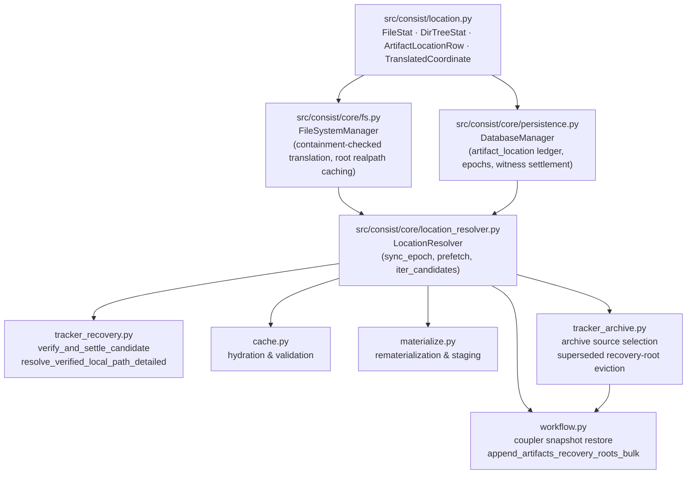

# Location Resolver Architecture

This page documents the internal architecture of Consist's Layer-2 location
resolution, coordinate translation, epoch synchronization, and stat-witness
verification pipeline. It is intended for contributors working on
`location.py`, `fs.py`, `persistence.py`, `location_resolver.py`,
`tracker_recovery.py`, `tracker_archive.py`, `cache.py`, `materialize.py`, and
`workflow.py`.

## 1. Overview & Component Architecture

Consist separates **location coordinates and stat witnesses** (value types),
**host path translation** (containment-checked filesystem mapping), **ledger
persistence** (DuckDB + epoch invalidation), and **candidate precedence**
(unified lazy enumeration) into distinct layers:

- `LocationResolver` (aliased as `MountPrecedenceResolver`) is bound lazily to
  each `Tracker` via `tracker.location_resolver` and serves as the single
  canonical source of candidate paths across recovery, cache validation,
  materialization, archiving, and coupler restoration.

## 2. Coordinate Translation & Three-View Symlink Semantics

Every coordinate translation via `FileSystemManager.translate_location_coordinate`
(and `translate_raw_root`) produces a `TranslatedCoordinate` with `status` in
`{"resolved", "unmounted", "rejected"}` and three distinct path views:

| View | Construction | Symlink Semantics | Primary Consumer |
| :--- | :--- | :--- | :--- |
| `lexical_path` | `lexical_root / rel_parts` | All symlinks visible (mount root and in-mount components) | Symlink rejection probes, `invert_relative_layout` |
| `mount_canonical_lexical_path` | `canonical_root / rel_parts` | Mount root resolved (`realpath`); in-mount symlinks visible | Symlink rejection probes inside a symlinked mount root (e.g. `/var` → `/private/var`) |
| `canonical_path` | Parent-canonicalized, leaf-preserving | Ancestor resolved; leaf name preserved if leaf itself is a symlink | Deduplication (`seen_canonical`), existence/digest checks |

### Single-Pass Containment

`FileSystemManager`'s containment check in `src/consist/core/fs.py` establishes
containment without requiring the target file to exist yet:

1. Starts at `probe = Path(os.path.abspath(candidate))` and walks upward using
   `os.lstat(probe)` (not `exists()`, so dangling symlinks do not look like
   missing files and instead fall through to strict resolution).
2. Collects any missing trailing path components in `tail`.
3. Once an existing ancestor is found, calls `probe.resolve(strict=True)`.
   Dangling symlinks, symlink loops (`RuntimeError`), or unreadable components
   (`OSError`) return `None`, which callers treat as a **fail-closed
   rejection**.
4. If `tail` is non-empty, joins `reversed(tail)` lexically onto `base` and
   returns `(joined, joined)`.
5. If `tail` is empty and the leaf itself is a symlink (`stat.S_ISLNK`),
   returns `(base, Path(os.path.realpath(probe.parent)) / probe.name)` so
   containment is checked against the resolved target `base` while
   `canonical_path` preserves the leaf name.

For mounted/rooted coordinates, `FileSystemManager` first rejects any `..`
segment in the relative path before joining, then verifies
`target.is_relative_to(canonical_root)` and returns `rejected_coordinate(...)`
if the resolved path escapes the root.

### Fail-Closed `mount_name == "abs"` Containment

When `mount_name == "abs"`, `translate_location_coordinate`:

1. Strips a leading `file://` prefix (returning `unmounted_coordinate` if empty).
2. Rejects any `..` segment in `PurePosixPath(stripped).parts` immediately.
3. Performs single-pass containment resolution on `Path(stripped)` and returns
   `rejected_coordinate(...)` if containment fails (dangling symlink, loop, or
   unreadable component).

### Root Realpath Caching

`FileSystemManager` caches resolved root metadata
`(lexical_root, canonical_root, inst_id)` keyed by
`(self.run_dir, self.sorted_mounts_key)`. Changing `run_dir` or `mounts`
automatically invalidates the cache on the next lookup.

## 3. Canonical Candidate Precedence & Lazy Tiering

`LocationResolver.iter_candidates(...)` yields deduplicated (by
`canonical_path`), containment-checked `ResolvedCandidate` instances in strict
precedence order:

| Tier | `ResolvedCandidate.source` | Origin | Notes |
| :--- | :--- | :--- | :--- |
| **1** | `"explicit_root"` | `source_root` argument | Combined with `remappable_relative_path(artifact)` via `translate_raw_root` |
| **2** | `"runtime_abs"` | `artifact.abs_path` | Emitted only when `include_runtime_abs=True` |
| **4a** | `"ledger_primary"` | `resolve_primary_coordinate(row, artifact)` | Evaluated across **all** active `ArtifactLocationRow`s first |
| **4b** | `"ledger_historical"` | `iter_historical_coordinates(row, artifact)` | Lazy fallback across active rows (excluding Tier 4a `canonical_path`s) |
| **5a** | `"historical_uri"` | `artifact.meta["mount_root"]` | Combined with `unprefixed_uri_relative_path(artifact.uri)` |
| **5b** | `"historical_uri"` | Owning `Run` / `historical_run` / `historical_run_dir` | Resolved via `fs.get_historical_root(...)` |
| **5c** | `"managed_mount"` | Current-run managed mount | Emitted when `(not candidate_rows and is_current_run) or include_current_uri` |

Within Tier 4b (`iter_historical_coordinates`), historical roots for non-`abs`
named mounts are gathered in order from: (1) owning-run metadata (`mounts` /
`archive_mounts`), (2) `artifact.meta["mount_root"]`, and (3) DB historical
mount index (`get_live_historical_mount_roots` then `get_historical_mount_roots`).
Candidates are ranked `(0: target exists, 1: root/prefix exists, 2: remaining
non-rejected)` while skipping `os.path.exists` probes on roots already known to
be dead in the current epoch.

### Why Tier 4a Precedes Tier 4b

`iter_candidates` exhausts `resolve_primary_coordinate` across every active row
(Tier 4a) **before** entering `iter_historical_coordinates` (Tier 4b). On HPC
clusters, historical rows often point to unmounted or slow Lustre/NFS `$SCRATCH`
filesystems; resolving and verifying an active local workspace or archive
coordinate in Tier 4a short-circuits iteration before any historical root is
probed.

### Bulk Prefetch & Rejection Callbacks

- `LocationResolver.prefetch(artifacts, runs=())` calls `sync_epoch()`,
  bulk-loads active location rows via `db.get_active_artifact_locations_bulk`
  into its per-epoch location-row cache, and bulk-loads owning runs via
  `db.get_runs_by_ids_chronological` into its per-epoch run cache.
- Callers can pass `on_rejected: Callable[[TranslatedCoordinate], None]` to
  `iter_candidates` to inspect rejected coordinates (for example, to record
  symlink rejections) without altering candidate enumeration.

## 4. Epoch Synchronization

`DatabaseManager` maintains two independent process-local epoch maps in
`src/consist/core/persistence.py`, keyed by the resolved database path:

- **Location epoch** (via `effective_location_epoch`,
  `sync_location_epoch_caches`, `bump_location_epoch`): incremented on
  `artifact_location` writes, witness updates, and evictions. Invalidates
  location resolution caches, ephemeral stale location state, settled-witness
  caches, active coordinate witnesses, and registered epoch invalidation hooks.
- **Mount epoch** (via `effective_mount_epoch`, `sync_mount_epoch_caches`,
  `bump_mount_epoch`): incremented only when mount history changes. Invalidates
  historical mount caches.

Keeping these two epochs separate ensures that ordinary `artifact_location`
writes do not thrash historical mount caches. For read-only connections, both
`effective_location_epoch` and `effective_mount_epoch` also include the DB and
WAL file stat stamps (`(mtime, size)`) so sibling `Tracker` handles pointing at
the same DuckDB file immediately observe writes and new mounts from other
handles or processes. `LocationResolver.sync_epoch()` tracks the location epoch
(`(db.effective_location_epoch, fs.workspace_instance_id)`) and mount epoch
(`(db.effective_mount_epoch, fs.sorted_mounts_key)`) separately, clearing its
location-row and run caches on location-epoch changes and its historical-mount
caches on mount-epoch changes.

## 5. Persisted `digest_verified` Witnesses

`FileStat` and `DirTreeStat` in `src/consist/location.py` carry
`digest_verified: bool = False`, serialized inside the `witness_json` JSON
column of `artifact_location`. Storing `digest_verified` inside the witness JSON
avoids requiring a DuckDB schema migration while keeping verification state
co-located with the stat tuple (without persisted `racy` state, avoiding 2x
Lustre reads and read-time DB writes on first-consumer jobs).

`verify_and_settle_candidate` in `src/consist/core/tracker_recovery.py` enforces
three invariants:

1. **Unverified `FRESH` witnesses cannot bless tampered bytes**: when
   `WitnessFreshness.FRESH` is returned, it fast-paths (`return True, False`)
   only if `not verify_digest` and either the artifact has no portable content
   identity or `effective_witness.digest_verified` is `True`. Otherwise it runs
   `verify_candidate_against_artifact(path, artifact)` and settles with
   `with_digest_verified(True)`.
2. **Race-safe stat-mismatch & witnessless verification**: when
   `WitnessFreshness.STAT_MISMATCH` (with portable content identity) or
   `effective_witness is None` is encountered, `verify_and_settle_candidate`
   captures `pre_w`, verifies the content digest, captures `post_w`, and calls
   `db.settle_artifact_location_witness(...)` only if `pre_w == post_w`.
3. **Carry-forward & no-op `UPDATE` suppression**:
   - During `artifact_location` upserts in `DatabaseManager`, if an incoming row
     has `loc.witness.digest_verified == False` while the existing row has
     `prev.witness.digest_verified == True`, `prev.digest == loc.digest`, and
     `prev.witness.with_digest_verified(False) == loc.witness.with_digest_verified(False)`,
     the existing `digest_verified=True` flag is carried forward onto `loc`.
   - `DatabaseManager.settle_artifact_location_witness` checks both its
     in-memory settled-witness cache and the persisted `witness_json` row; if
     `existing_witness == verified_witness`, it returns without issuing a DuckDB
     `UPDATE`, avoiding unnecessary write transactions across fresh SLURM jobs.

## 6. Non-Obvious Invariants & Design Decisions

- **Excluding `workspace` / `runs` from archive recovery roots**: in
  `tracker_archive.py`, source-mount recovery-root extraction returns `None` for
  `workspace://` and `runs://` URIs (and when the resolved mount root equals
  `self.fs.run_dir`) so workspace-local outputs are not redundantly registered as
  `site="archive"` recovery roots.
- **Multi-coordinate archive eviction**: when an archive root is overwritten,
  `tracker_archive.py` constructs eviction coordinates for the normalized archive
  coordinate, `("abs", "", f"file://{resolved_target}")`,
  `("abs", "", f"file://{lexical_target}")`, and any active or historical
  named-mount alias where `resolved_target.is_relative_to(resolved_mount)`, then
  passes them together to `db.evict_recovery_root_locations(...)`. For schemes
  with multiple historical mount roots where only a subset match the target,
  eviction filters rows in SQL by relative archive subpath and checks each
  row's owning run mount (falling back to coordinate resolution only when no
  owning mount is recorded) so rows pointing outside the overwritten root stay
  active.
- **Lazy per-candidate symlink rejection**: `LocationResolver.iter_candidates`
  yields candidates lazily, and archive source selection in
  `tracker_archive.py` checks for symlink components on `cand.lexical_path` and
  `cand.mount_canonical_lexical_path` per candidate, recording the first rejected
  symlink path and continuing rather than aborting. An unrelated historical
  symlink therefore never poisons a clean primary candidate.
- **`unprefixed_rel` climb guard & parent-to-child recovery**:
  `FileSystemManager.invert_relative_layout(target_path, rel_path)` requires
  `len(target_parts) > len(rel_parts)` (strictly greater, preventing climbing
  above filesystem root). In `resolve_verified_local_path_detailed`, when a
  child artifact with `parent_artifact_id` (such as an `OutputSet` member) has
  no direct hit, recovery resolves `parent` via `LocationResolver.iter_candidates`,
  inverts `parent_rel` with `invert_relative_layout`, and translates
  `rel_path` under `parent_root` via `fs.translate_raw_root`.
- **Coupler snapshot bulk recovery registration**: during coupler snapshot
  restoration in `src/consist/core/workflow.py`, restored artifacts with
  resolved source roots are collected into `pending_recovery_roots` and
  committed in one batch via
  `self.tracker._archive_service.append_artifacts_recovery_roots_bulk(pending_recovery_roots)`
  (single DB transaction and sidecar pass).
